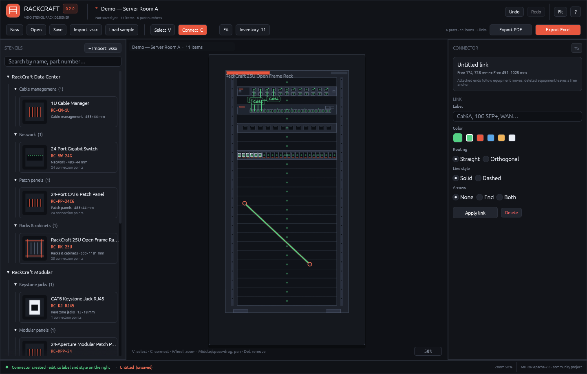

# RackCraft

**A native Rust rack and structured-cabling diagram designer, compatible with
Visio stencils (`.vssx`) and Excel bills of materials.**

[](https://github.com/emilio-n8n/rackcraft/actions/workflows/ci.yml)
[](https://github.com/emilio-n8n/rackcraft/actions/workflows/release.yml)
[](#license)
[](https://www.rust-lang.org)

RackCraft is a focused desktop alternative to Microsoft Visio for assembling
equipment in technical racks: drop in a rack, patch panels, switches, cable
managers and keystone jacks, snap them to rack units and modular apertures, fill
in manufacturer shape data, then export the inventory to Excel.



It follows the layout and engineering conventions of the
[ArtCraft ecosystem](https://getartcraft.com/) (`cargo` workspace, pure-Rust
`egui`/`eframe` UI, `--sample` convention, checksum-published releases), but it
is a **community project**: it is not developed, endorsed or supported by
Storytold or the ArtCraft team.

> **Project status: 0.1.1 MVP.** The parser and editor handle the common Visio
> 2013+ stencil subset used by cabling vendors: masters, vector geometry,
> connection points, icons and shape data. Legacy binary `.vss` files are
> detected and can be converted with LibreOffice when it is installed.

## What works

- **Native, vector canvas** — infinite zoom to port level, pan, drag to place,
  select, duplicate and delete. Everything is drawn from embedded normalized
  paths, never from raster screenshots.
- **Stencil browser** — import `.vssx` libraries, search by name, browse by
  category with thumbnail previews.
- **Magnetic snapping** — equipment aligns to rack `U` slots and stencil
  connection points; a bright green marker confirms the glue.
- **Shape data** — manufacturer, part number and product description are read
  from the stencil, while installed date, warranty expiry, location, building
  and notes are editable project fields.
- **BOM / inventory** — live grouping by part identity and quantity; export to
  a formatted `.xlsx` workbook or UTF-8 `.csv`.
- **Self-contained documents** — save and open `.json` files with undo/redo
  history intact during the session. Documents do not need the original stencil
  library to render or compute a BOM.
- **Offline samples** — two realistic `.vssx` libraries ship in `samples/`; the
  binary's `--sample` flag opens a ready-made rack.

## Quick start

Prerequisites: Rust 1.95+ and the usual Linux windowing development packages
(`libxkbcommon-dev`, `libxkbcommon-x11-dev`, `libwayland-dev`, `libx11-dev`,
`libxcursor-dev`, `libxrandr-dev`, `libxi-dev`, `libgl1-mesa-dev`).

The prebuilt Linux archive is built on Ubuntu 22.04 (glibc 2.35) and needs the
runtime libraries `libxkbcommon-x11-0`, `libwayland-client0` and `libgl1`
(normally already installed on a desktop Linux system).

```bash
cargo run -p rackcraft -- --sample
```

Or launch empty and import a stencil library:

```bash
cargo run -p rackcraft
```

In the app: use **Load sample** in the toolbar, **Import .vssx** to add a
library, then drag a shape from the left panel onto the rack. Middle-drag (or
space-drag) pans; the wheel zooms under the cursor. **Inventory** shows the BOM
and **Export Excel** writes it.

### Build for release

Release builds are produced by GitHub Actions for Linux x86_64 (tar.gz and
AppImage), Windows x86_64, macOS Apple silicon and macOS Intel. To build
locally anyway:

```bash
cargo build --release -p rackcraft
```

### Linux AppImage

Download `rackcraft-x86_64.AppImage` from the
[latest release](https://github.com/emilio-n8n/rackcraft/releases/latest), then:

```bash
chmod +x rackcraft-x86_64.AppImage
./rackcraft-x86_64.AppImage --sample
```

The AppImage is built on Ubuntu 22.04 (glibc 2.35) and runs on rolling
distributions such as Arch Linux and CachyOS. It uses the system's Wayland/X11,
Mesa and font libraries. If FUSE 2 is unavailable, run it with
`APPIMAGE_EXTRACT_AND_RUN=1` or install `fuse2`.

## Samples

| File | Contents |
| --- | --- |
| `samples/rackcraft-datacenter.vssx` | 25U wall rack, 24-port CAT6 patch panel, 24-port switch, 1U cable manager |
| `samples/rackcraft-modular.vssx` | 24-aperture modular panel, keystone RJ45 jack |
| `samples/README.md` | fixture provenance and regeneration instructions |

The samples are hand-authored fixtures with the same XML structure as vendor
Visio stencils (masters, geometry, connections, shape data). They are free to
use under the project's licences and keep the application fully functional
offline and the test suite deterministic.

## Architecture

```
apps/rackcraft        native binary, --sample flag
  └── crates/ui-egui  dark egui UI: browser, canvas, shape data, BOM window
        ├── crates/io     .vssx parser, .vss detection, xlsx/csv export
        │     └── crates/engine  document, units, snap, undo, BOM, JSON
        └── (egui, eframe, rfd)
```

- `engine` is UI- and filesystem-free; all geometry is in millimetres, with
  `1 U = 44.45 mm`.
- `io` parses OPC/ZIP + Visio XML with `roxmltree`, converts master geometry to
  `kurbo` paths, extracts normalized graphics, connection points and shape
  data.
- `ui-egui` owns only presentation and interaction state. Stencil parsing is
  done by `io`, document mutations by `engine`.
- See [`AGENTS.md`](AGENTS.md) for the full contribution and environment rules,
  and [`docs/visio-format.md`](docs/visio-format.md) for the supported Visio
  subset.

To inspect a stencil from the command line:

```bash
cargo run -p rackcraft-io --example stencil_info -- samples/rackcraft-datacenter.vssx
```

### Visio compatibility

- `.vssx` (Visio 2013+ Open XML stencil) is the supported format.
- Groups, rotated/flipped shapes, lines, cubic/quadratic Béziers, ellipses,
  arcs and NURBS endpoints are flattened into normalized drawable paths.
- `Connection` rows become snap anchors; `Property`/`ShapeData` rows become
  editable shape data. Master icons are decoded from the embedded ICO payload
  for the stencil browser.
- Binary `.vss` is detected by its CFB signature. If `soffice` is on `PATH`,
  RackCraft converts it to `.vssx` in a temporary directory; otherwise it shows
  the exact conversion command to run. Visio for the web / desktop can also
  re-save a `.vss` as `.vssx`.

## Development

```bash
cargo fmt --all -- --check
cargo clippy --workspace --all-targets -- -D warnings
cargo test --workspace
```

In the constrained Cloud Shell environment, always build into `/tmp`:

```bash
export CARGO_TARGET_DIR=/tmp/cargo-target
cargo test -p rackcraft-engine -p rackcraft-io
```

CI runs the three checks above on Ubuntu. The release workflow builds all four
platform targets, packages `.tar.gz`/`.zip` archives, publishes a
`SHA256SUMS.txt` and attaches everything to the GitHub Release.

## Community & independence

RackCraft is an independent open-source project maintained by its contributors.
It is **not** an official ArtCraft application. “ArtCraft”, “VectorCraft”,
“Visio” and other names are trademarks of their respective owners and are used
only to describe compatibility and inspiration. Please report RackCraft issues
to this repository, not to Storytold or Microsoft.

Contributions are welcome under the MIT OR Apache-2.0 dual licence.

## License

Licensed under either of:

- Apache License, Version 2.0 ([LICENSE-APACHE](LICENSE-APACHE))
- MIT License ([LICENSE-MIT](LICENSE-MIT))

at your option. Unless you explicitly state otherwise, any contribution
intentionally submitted for inclusion in this project shall be dual-licensed as
above, without any additional terms or conditions.
